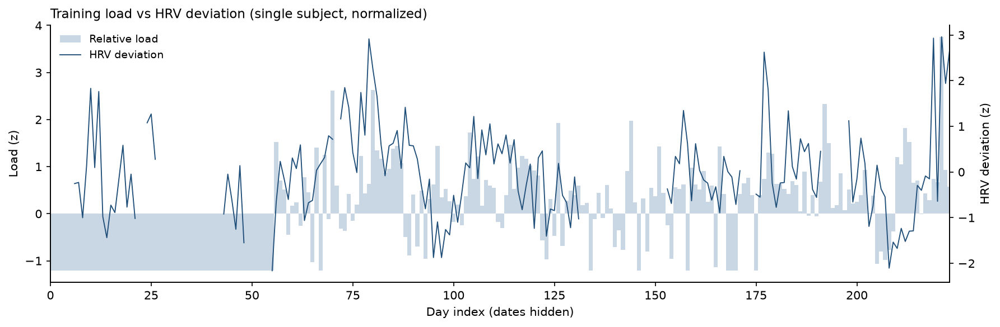

# LeaderCoach

[](README.en.md)
[](README.md)

A local-first multi-sport training engine. Garmin data is imported into a local
database; deterministic code computes load, recovery and safety gates; the engine
returns today's session. The LLM only performs adjustment and explanation — it
does not take part in runtime computation.



> Single-subject real data. The x-axis is a relative day index and the y-axis is
> normalized; dates and absolute values are hidden.

## Architecture

| Layer | Location | Role |
|---|---|---|
| Acquisition | `ingest/` | Garmin plugin MCP, FIT/CSV parsing, weather |
| Observation | `ml/features.py`, `core/daily.py` | Daily panel, HRV deviation, CTL/ATL/TSB, ACWR |
| Models | `ml/` | Ridge / GBM, walk-forward; research prototype |
| Control | `core/engine.py`, `core/templates.py` | G1–G10 gates, T1–T6 templates |
| Explanation | `coach/` | LLM performs adjustment and explanation only |

## Data

- Activities: Garmin FIT / CSV;
- Daily physiology: HRV, sleep, resting heart rate, stress;
- Labels: daily subjective state + post-session RPE/Feel;
- Weather: Open-Meteo (optional).

## Privacy

This repository contains **framework code only**, with no personal data:

- Not included: FIT files, CSV exports, databases, backups, athlete profile,
  race results, dates, or physiological values;
- The figure uses single-subject real data, but dates and absolute values are hidden;
- Full data can be shared separately after contacting the author.

## Results

Data through **2026-10-20**, **n=175**.  
If numbers differ later, the latest `python -m ml.transition` output prevails.

| Model | MAE | R² |
|---|---|---|
| Ridge | 13.711 | −0.248 |
| GBM | 15.316 | −0.454 |

- Classification baseline: macro-F1 ≈ 0.29–0.31 (chance level);
- Incremental R² of long-window exposure for subsequent sleep ≈ 0;
- Conclusion: the current models **must not be used for decisions**. The
  bottleneck is causal identification, not model capacity.

## Quick start

```powershell
python -m venv .venv
.venv\Scripts\activate
pip install -r requirements.txt -r requirements-ml.txt

# 1) Install the Garmin plugin (MIT, not bundled with this repo)
npm i -g dsh-plugin-garmin-connect

# 2) Point to the plugin via environment variables (never hard-code paths)
$env:GARMIN_PLUGIN_MCP_JS  = "<plugin-dir>\lib\mcp.js"
$env:GARMIN_PLUGIN_SESSION = "<plugin-session-file>"
$env:GARMIN_PLUGIN_NODE    = "node"

# 3) Initialize, sync, and get today's session
python main.py init
python main.py sync --days 60
python main.py today
```

## Layout

```
core/       Engine: load, recovery, gates, template selection
ingest/     Acquisition: plugin bridge, FIT/CSV, weather
ml/         Models: features, baselines, transition, exposure, anchors
templates/  T1–T6 templates
db/         schema.sql / seed.sql
mcp_server/ MCP tools
coach/      Prompt templates
tests/      Engine and schema tests
```

## License

- Project code: MIT, see `LICENSE`;
- Third-party components and references: see `THIRD_PARTY_NOTICES.md`;
- Raw Garmin data is not distributed with this repository; users collect their own.
