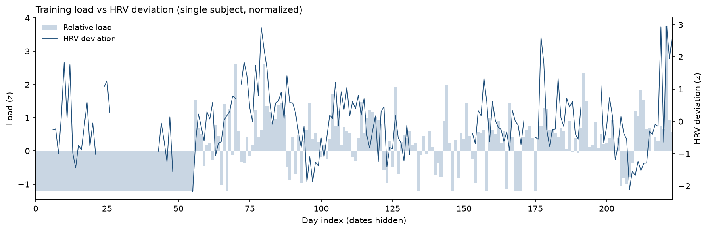

# LeaderCoach

[](README.md)
[](README.en.md)

本地优先的多运动训练引擎：把可穿戴设备的数据读入本地数据库，用确定性代码计算负荷、
恢复状态与当天的训练预测，再给出当天的训练安排。LLM 只做调整与解释，不参与运行时计算。

数据源按 `source` 隔离（不同设备的 HRV / 静息心率定义不同，基线不能混算），
目前接入 Garmin（`garmin-coach`）与 COROS（`coros-coach`），两者共用同一个库与同一套 `core/`。

> 术语说明：代码与文档里的 **训练预测**（`training_forecast`，编号 G1–G10）指"今天可能
> 需要调整的情况"，不是安全审查；**主观记录**（`logging`）指每日主观状态与补录节奏；
> **训练安排**代替了早期的"处方"说法。数据库列名 `gates_triggered` 属于历史字段，含义
> 与训练预测相同，保留只为兼容旧数据。



> 单被试真实数据；横轴为相对天数，纵轴为标准化值，日期与绝对值已隐去。

## 版本迭代

MCP 的能力和使用范围会根据后续版本的需求不断完善、更新：

- 最开始只求把链路跑通，读的是活动摘要和少量日指标（睡眠时长、HRV、静息心率、压力均值），
  主要为了验证"数据 → 引擎 → 训练安排"这条线能不能闭合。
- 之后随着表结构、解析器和校验逻辑陆续补齐，才逐步扩到插件的全部只读工具，并加上睡眠阶段
  时间线、夜间序列、运动分段和官方训练指标。
- 所以 `docs/` 里早期文档写着"只有运动数据""睡眠 0 天"，那是当时的真实状态，现在请看
  `README` 的数据表和 `store_ext.stats()` 的覆盖度。

## 架构

| 层   | 位置                                   | 作用                               |
| --- | ------------------------------------ | -------------------------------- |
| 采集  | `ingest/`                            | Garmin 插件 MCP、FIT/CSV 解析、天气      |
| 观测  | `ml/features.py`、`core/daily.py`     | 日面板、HRV 偏离、CTL/ATL/TSB、ACWR      |
| 模型  | `ml/`                                | Ridge / GBM、walk-forward；当前为研究原型 |
| 控制  | `core/engine.py`、`core/templates.py` | G1–G10 训练预测、T1–T6 模板               |
| 解释  | `coach/`                             | LLM 只做调整与解释                      |

## 数据

- 活动：Garmin FIT / CSV；
- 每日生理：HRV、睡眠、静息心率、压力；
- 标签：每日主观 + 运动后 RPE/Feel；
- 天气：Open-Meteo 逐小时（按活动 GPS 取点，`ingest/weather_hourly.py`）；
- 海拔：FIT `enhanced_altitude` 绝对海拔 → `activities.alt_*` 九列
  （`core/altitude.py` + `scripts/backfill_altitude.py`）。

### 环境暴露（海拔 / 气温 / 湿度）

```powershell
D:\LeaderCoach\.venv\Scripts\python.exe -m ingest.weather_hourly --start 2026-03-11
D:\LeaderCoach\.venv\Scripts\python.exe -m scripts.backfill_altitude   # 逐场绝对海拔
D:\LeaderCoach\.venv\Scripts\python.exe -m core.environment           # 公式自检
D:\LeaderCoach\.venv\Scripts\python.exe -m core.altitude              # 海拔自检
```

写入 `weather_hourly`（逐小时）/ `weather_activity`（活动级起跑时刻与场内变化）/
`weather_exposure`（7 天体感均值、14 天 ≥28°C 训练小时、14 天热剂量）。
海拔不单独采：FIT 的 `enhanced_altitude` 就是气压绝对海拔，回填进
`activities.alt_mean_m / alt_min_m / alt_max_m / alt_sd_m / alt_start_m / alt_end_m /
alt_samples / alt_source / alt_status`，再用 `core/environment.py` 换成气压、PIO2、
VO2max 惩罚与 HRmax 修正。`alt_sd_m`（场内海拔标准差）可直接充当**路线起伏度**协变量。

方法论见 `docs/altitude_weather_effects.md`（四种海拔效应、公式、可识别性分级）。

### Garmin 插件全量采集（v1.8）

`python main.py sync` 与 MCP 的 `sync_garmin` 默认走 **`ingest/plugin_full.py`**，
调用插件的全部只读工具，原始返回 gzip 存档到 `archive/plugin_raw/`：

| 类别 | 工具 | 落到哪里 |
| --- | --- | --- |
| 活动 | `get_garmin_activities`（full 详情） | `activities`（心率区间、训练效果、官方负荷、步态）+ `garmin_activities` |
| 睡眠 | `get_garmin_sleep` | `daily_metrics`（时长/分期/入睡与醒来时刻）+ `garmin_metrics.sleep_score` |
| 睡眠阶段 | SDK 直读 `getSleepData`（`ingest/_sdk_sleep_probe.js`） | `sleep_stages`（阶段时间线）+ `sleep_series`（夜间心率/压力/身体电量/HRV/呼吸） |
| HRV | `get_garmin_hrv` / `get_garmin_hrv_summaries` | `hrv_readings`（每 5 分钟读数）+ `garmin_metrics`（5 min 峰值、周均值、平衡中心） |
| 压力 / 身体电量 | `get_garmin_stress` / `_summaries` / `get_garmin_body_battery` | `stress_series`、`body_battery_series`、`daily_metrics.stress_daily_avg` |
| 训练 | `get_garmin_training_readiness` / `daily_training_status` / `training_status` / `training_load_balance` / `max_metrics(_range)` / `race_predictions(_range)` | `garmin_metrics` + `official_snapshot` |
| 其它 | 心率、步数、体重、训练库、个人资料 | `garmin_metrics` / 原始存档 |
| 运动分段 | 本地 FIT 的每公里分段 + 设备圈分段（**两套并存**） | `activity_split_detail`（每段距离/用时/配速/均心率/最高心率/爬升/下降/净爬升/平均坡度/最大坡度/**GAP**/起止时刻）+ 兼容副本 `activity_splits` |

- 原始存档按 `tool/日期.json.gz` 保存（同名时更新为本轮返回）；解析器有变更时可
  `python -m ingest.plugin_full --replay` 用同一份存档重新解析回填。
- 历史回填按月分段跑（单次跨度要 ≤31 天，这是插件接口的限制）：
  `python -m ingest.plugin_full --start 2026-06-01 --end 2026-06-30`。
- `get_daily_brief` 的 `recovery` 新增 `sleep_window`、`sleep_detail`、`overnight_series`、
  `garmin_official`；`get_sleep_detail` 可拉取单日的完整阶段时间线与夜间序列。
- 旧的最小采集路径仍可用：`python main.py sync --legacy` 或 `sync_garmin(full=False)`。
- Garmin 官方指标是**隔离层**，只作参考，不参与自算准备度；`config.toml` 的
  `[garmin_plugin]` 可调 `raw_dir` / `full_sync` / `replay_raw_each_sync`。

### 坡度-配速分析（v1.12）

`core/grade.py` 从 FIT 的 `enhanced_altitude` 逐点还原每公里爬升与坡度，并据此给出
**坡度调整配速（GAP）**，用于在起伏路线上公平比较「同样用力跑得快不快」。

**爬升统计**用阈值累计法（迟滞），避免气压/GPS 噪声把总爬升放大数倍：

- 相邻海拔变化累计超过 `[grade] min_climb_m`（默认 1.5 m）才计入爬升，否则丢弃；
- 实测该阈值下总爬升约为 Garmin 官方 `total_ascent` 的 **0.9 倍**，且各次活动一致
  （比值稳定比绝对值更重要——趋势分析只依赖一致性）；
- 调到 3–5 m 会更保守，只统计明显爬坡。

**GAP** 用 Minetti et al. (2002) 跑步代谢代价方程：

```
Cr(i) = 155.4·i⁵ − 30.4·i⁴ − 43.3·i³ + 46.3·i² + 19.5·i + 3.6     [J·kg⁻¹·m⁻¹]
ratio = Cr(i) / Cr(0)                                   Cr(0) = 3.6
GAP   = 实际配速 ÷ ratio
```

方向说明：能量速率守恒 `Cr(i)·v = Cr(0)·v_flat`，而配速是速度的倒数，
所以是**除以**代价比。上坡 ratio>1 → GAP 比实际配速**快**（同样用力在平路能跑更快）；
缓下坡 ratio<1 → GAP 更慢。校验：上坡 5% 跑 5:00 → GAP 约 3:51。

坡度按 `[grade] window_m`（默认 50 m）滑动窗口计算——FIT 海拔分辨率 0.1 m、采样约 4 m，
逐点算坡度会得到 1 m/20 m = 5% 的假陡坡。

#### 分段分析原因

先说结论：**整次活动的爬升密度不能拿来判断坡度对分段配速的影响**。同一个平均值，既可能
来自一路缓坡，也可能来自陡上陡下交替，两者的分段体验完全不同。下面是自己数据里的实测对比
（近 8 次 10 km 以上跑步）：

| 日期 | 距离 | 活动平均实际−GAP | 分段内最大修正 | 倍数 |
| --- | --- | --- | --- | --- |
| 2026-11-04 | 18.0 km | 0.5 s | **46.9 s** | 94× |
| 2026-11-01 | 12.7 km | 2.1 s | **48.0 s** | 23× |
| 2026-10-22 | 10.0 km | 1.2 s | **55.1 s** | 46× |
| 2026-10-23 | 11.2 km | 1.1 s | **25.9 s** | 24× |

也就是说，活动平均把分段级的坡度效应抹掉了 4–94 倍。所以在实现上：

- `climb_density_m_per_km` 只当**路线画像**看，不参与分段坡度影响的判断；
- 结论一律来自 `terrain_breakdown`（分地形统计）、`segment_deviation`（GAP 归一化后
  找真正费力的段）和 `max_segment_gap_delta_sec`（分段修正幅度）。

#### 分段地形分类

每公里按段内的爬升和下降各贴一个标签。只看净坡度会掩盖复合地形——比如先爬 18 m 再降 10 m，
净爬升只有 8 m，但那一公里实际是"上上下下"的：

| 标签 | 判定 |
| --- | --- |
| `mixed` | 段内既有 ≥8 m 上升又有 ≥8 m 下降（净坡度自相抵消，必须单列） |
| `climb` | 平均坡度 ≥ +0.5% |
| `descent` | 平均坡度 ≤ −0.5% |
| `rolling` | 段内起伏/距离 ≥ 1% 但净变化 < 0.5% |
| `flat` | 其余 |

#### 上坡惩罚 vs 下坡收益（不对称）

跑步对坡度的响应是**不对称**的：上坡要额外做功，下坡只能往回捞一部分（离心制动、步频受限）。
如果上下坡混在一起拟合一条直线，两边互相抵消，R² 必然很低——这不等于坡度没影响，是模型用错了。

所以做法是**上下坡分开回归 + 跨活动池化**。单次活动的上坡段常常只有 4–10 个，坡度信号会被
训练意图、疲劳、补给停顿淹掉，斜率连符号都可能是反的（实测出现过 −50 s/1%）。池化 276 次
跑步、1739 个分段之后：

- 上坡惩罚 **19.3 s / 1% 坡度**（典型跑者 10–20）
- 下坡收益 **14.66 s / 1%**
- `asymmetry_ratio` = 0.76（下坡只能收回约 3/4 的上坡损失）

单次活动只有在上下坡段各 ≥6 个、且拟合 R² ≥ 0.20 时才输出斜率；不够就标
`insufficient_samples` / `uphill_unreliable` 并把数值藏起来——信噪比不足时不给数，
比给个错的强。

#### 样本量约束

- 单次活动：不做趋势判断，只做分段构成与 GAP 偏离；
- 按周斜率：**不给**。单周上坡段只有 5–15 个，斜率会在 −8 ~ +51 s/% 之间乱跳，是噪声；
- 阶段对比（`period_compare`）：每侧需 ≥40 个上坡段，且标注两侧 R²，低置信度时明确说明；
- 全周期池化（`overall`）：样本上千，最可信。

MCP 工具：

- `get_activity_detail(activity_id, granularity="km")` — 每段带爬升/下降/净爬升/平均坡度/最大坡度/GAP；
- `get_grade_analysis(activity_id)` — 单次活动的逐段地形明细 + 坡度-配速响应；
- `get_grade_analysis()` — 跨活动统计：全周期池化的上下坡响应、近 N 周 vs 之前 N 周的对比、
  以及按周的分段级地形构成。

### 数据可用性随设备设置变化（以本账号实测为准）

| 数据 | 实测覆盖 | 说明 |
| --- | --- | --- |
| 睡眠汇总 + 入睡/醒来时刻 | 2026-03-11 起完整 | 早期接口不带阶段时间线，但有窗口和分期小时数 |
| 睡眠阶段时间线 + 夜间序列 | **2026-06-01 起** | SDK 只对近期数据返回 `sleepLevels` / 心率 / 压力序列 |
| HRV 每 5 分钟读数 | 约 6 月起，125/149 天 | 部分夜晚接口返回空数组 |
| 压力 / 身体电量时间序列 | **2026-06-01 起** | 更早的日期 `stressValuesArray` 为空，只有日均值 |
| 训练状态 / 负荷平衡 / 比赛预测 | 2026-03-11 起完整 | |
| 活动完整详情 | 仅最近约 100 条 | 插件不按日期过滤活动，回填不会补到更早的活动 |

### 睡眠状态评分（v1.9）

睡眠模块的目标不是预测睡眠，而是**用昨晚的睡眠推断今天恢复到什么程度**，再决定当天练什么。
实现见 `core/sleep_health.py`，输出写入 `garmin_metrics`（`sleep_state_score` 及各维度）。

六个维度（0–100，加权合成 SSHI）：

| 维度 | 依据 | 权重 |
| --- | --- | --- |
| 时长 duration | 相对**个人睡眠需要量**的偏差 + 7 天睡眠债 | 0.25 |
| 规律 regularity | 相邻两天的睡眠规律指数（SRI，5 分钟 epoch 一致率）；缺阶段时用睡眠中点离散度 | 0.25 |
| 时序 timing | 睡眠中点相对个人 28 天中点的偏移 | 0.10 |
| 效率 efficiency | 总睡眠 / 卧床时间 | 0.15 |
| 稳定 stability | 夜间清醒时长、觉醒次数、阶段切换频率 | 0.15 |
| 主观 subjective | `sleep_feel` 1–5；缺省时按客观项推算并标记 `derived` | 0.10 |

**个人睡眠需要量是初始化时设定的定量**：在运动档案里写 `athlete_profile.sleep_need_h`
（本项目当前设为 **7.5 h**），每名运动员按自己的情况设定；`config.toml` 的
`sleep.personal_need_h` 只在该字段为空时兜底。AASM 的 7–9 h 仅作为下限参考，
**不覆盖个人设定**。

接入方式：

- 睡眠支柱改用 `sleep_state_score`，替代原来"睡了几小时"的绝对插值（缺该分数时自动退回）。
- 观察结果（6–10 月 149 天）：按 `min(p10, 60)` 共有 **11 天**满足条件，
  0 天真正拦截（`sleep_g8_enforced` 全为 0）。这些天将作为后续验证的候选样本。
- 训练预测 G8 默认处于**观察模式**（`sleep.g8_mode = "observe"`）：触发条件是
  `睡眠状态分 < min(个人 28 天 p10, 绝对下限 60)`，命中时只把 `sleep_g8_triggered=1`
  及阈值写进 `garmin_metrics` 和简报，**不改变当天训练安排**。要真正拦截，需显式把
  `g8_mode` 改成 `"enforce"`；没有睡眠分时才退回 `sleep_hours_floor` 的绝对时长判断。
  设为观察模式的原因：现有数据里睡眠分对当天表现几乎没有预测力（见下），
  先积累“若启用会命中哪些天”的证据，再决定是否值得砍质量课。
- 分期（深/浅/REM）只用于夜间稳定与解释，**不单独触发调整**——手腕设备的分期误差较大。

### 主观记录与"默认值填写"约定

- `log_subjective` 的 `sleep_feel` 是睡眠模块的**主观项**，保留独立权重。入参可以直接报
  1–10（用户习惯的说法），工具内部按规则折算到库里的 1–5 制并回显折算结果。
- **允许默认值落库**：用户没有对"醒来后的身体状态"提出异议时，按睡眠引擎预测的感受
  （由睡眠时长/规律性/效率与个人基准推算）填写即可，`note` 里注明 `source: derived`；
  用户明确提出异议时再覆盖，并保留原预测值便于事后比对。
- 这样不会因为漏填而让主观支柱长期缺失；但**主观项永远是修正项，不替代客观睡眠指标**，
  也不作为训练预测的唯一依据（与 `sleep_detail` 一起解释）。

### 当前验证结果（描述性，不作因果结论）

6–10 月共 149 天有睡眠状态分（均值 79.1，SD 10.7）。与当天/次日状态的关系：

| 对照 | 相关系数 | n |
| --- | --- | --- |
| 同日活动 RPE | 0.09 | 130 |
| 同日 Feel | −0.12 | 128 |
| 跑步速度/心率 | −0.09 | 175 |
| 次日 HRV | 0.05 | 124 |

**结论：在这份数据里，睡眠状态分对当天主观用力与表现几乎没有线性预测力。**
这与本项目此前的负结果一致（训练负荷对睡眠的增量 R²≈0），也和文献中"睡眠与次日
HRV 只有弱相关"相符。因此当前只把睡眠用作**保守的排除条件**（极差时不给质量课），
不把它当作训练强度的正向依据；后续需要更多"同配速下的心率漂移/计时测试"这类
表现锚点，才谈得上验证它是否真的有用。

## 隐私

本仓库**只含框架代码**，不含任何个人数据：

- 不上传：FIT、CSV、数据库、备份、个人档案、成绩、日期与生理数值；
- 图示为单被试真实数据，但已隐去日期轴与绝对值；
- 完整数据可在与作者沟通后单独提供。

## 结果

数据截至 **2026-10-20**，**n=175**。  
若后续数字有差异，以最新一次 `python -m ml.transition` 的输出为准。

| 模型    | MAE    | R²     |
| ----- | ------ | ------ |
| Ridge | 13.711 | −0.248 |
| GBM   | 15.316 | −0.454 |

- 分类基线 macro-F1 ≈ 0.29–0.31（chance 水平）；
- 长窗口暴露对后续睡眠的增量 R² ≈ 0；
- 结论：当前模型**不能用于决策**，瓶颈在因果识别，不在模型容量。

## 快速开始

```powershell
python -m venv .venv
.venv\Scripts\activate
pip install -r requirements.txt -r requirements-ml.txt

# 1) 安装 Garmin 插件（MIT，单独安装，不随本仓库分发）
npm i -g dsh-plugin-garmin-connect

# 2) 用环境变量指定插件路径（不要写进代码）
$env:GARMIN_PLUGIN_MCP_JS  = "<插件目录>\lib\mcp.js"
$env:GARMIN_PLUGIN_SESSION = "<插件会话文件>"
$env:GARMIN_PLUGIN_NODE    = "node"

# 3) 初始化、同步、今日安排
python main.py init
python main.py sync --days 60
python main.py today
```

## 目录

```
core/       引擎：负荷、恢复、训练预测、模板选择
ingest/     采集：插件桥、FIT/CSV、天气
ml/         模型：特征、基线、转移、暴露、锚点
templates/  T1–T6 模板
db/         schema.sql / seed.sql
mcp_server/ Garmin MCP 工具
coros_mcp/  COROS MCP（独立进程，共用 core/ 与同一个库）
scripts/    独立脚本：COROS 授权、活动导入、海拔回填
coach/      提示词模板
tests/      引擎与 schema 测试
```

## 更新

- 2026-11-12（v1.16）：`SCHEMA_VERSION` 升至 **1.8**。上一版改了 DDL（四张表主键加
  `source`）却没跟着升号，会让 `verify` / `check_version` 显示旧值而误导排查；
  现在迁移完成时会自动补上版本戳，且迁移只复制两表都有的列，从更老版本升上来
  不会因缺列而崩。删除早期探针脚本 `scripts/coros_import.py`（已被 `coros_mcp/` 取代）。
- 2026-11-12（v1.15）：新增 `coros-coach`——独立的 COROS MCP，与 `garmin-coach`
  并列。数据进同一个库、分析用同一套 `core/`，靠新增的 `source` 维度隔离：
  `activities` 加 `source`/`external_id` 并以 `(source, external_id)` 做唯一键，
  `daily_metrics`/`engine_daily`/`sleep_stages`/`garmin_metrics` 主键加 `source`，
  旧库在 `get_conn` 里只读探测后单事务重建（幂等）。所有基线窗口、负荷序列、
  睡眠评分、坡度池化统计、RPE 定位按源过滤；新增 `[source] active` 显式指定当前源，
  不自动推断（两台设备同时戴会一天一个口径）。`sleep_series` 不加 `source`：
  它是 SDK 直读的分钟级序列，COROS 只给阶段百分比，只有一个生产者。
  同版本顺手修掉 `get_conn` 每次开连接都抢写锁导致并发 `database is locked` 的问题。
- 2026-11-11（v1.14）：修复僵尸同步任务。进程中途退出后，`sync_jobs` 里的 `running`
  不会结束，状态面板一直显示「同步卡住」。现在启动时与 `get_sync_status` 读取前会回收：
  内存中不存在、且启动超过 30 分钟的 `running` 记为 `interrupted`。同步改为串行执行。
- 2026-11-05（v1.13）：`log_activity_rpe` 新增 `activity_id`（同日多课时定位到指定活动，
  歧义时返回 `E_AMBIGUOUS` 并列出候选、已有 RPE 返回 `E_ALREADY_SET` 需 `overwrite=true`），
  返回体带上被命中的活动信息；`log_subjective.sleep_feel` 接受 1–10 并自动折算到 1–5；
  修复 `get_sync_status` 的 `obs_state` 序列化（原为 `sqlite3.Row` 对象）与 `logging`
  口径（固定当天并回显 `as_of`）；同步任务历史落库到 `sync_jobs`，进程重启后仍可回溯。
- 2026-11-05（v1.12）：新增 `core/grade.py` 坡度-配速分析（Minetti GAP、分段地形分类、
  跨活动池化的上坡惩罚/下坡收益）；新增 MCP 工具 `get_grade_analysis`；分段覆盖补齐至
  568/569 个活动；合并 39 组 CSV/插件重复活动（负荷字段迁移后删记录）。
- 2026-11-05（v1.11）：修复运动分段长期缺失——`start_time` 被截成日期导致 FIT 无法对齐活动；
  新增 `activity_split_detail` 表（每公里/设备圈两套并存）与 `get_activity_detail`；
  `sync_garmin` 改为异步 job，长同步不再阻塞对话。
- 2026-10-27（v1.10）：G8 改为观察模式——触发条件 `睡眠状态分 < min(个人 28 天 p10, 60)`，
  只写入 `garmin_metrics` 与简报、不改变训练；`sleep.g8_mode="enforce"` 才真正拦截。
- 2026-10-27（v1.9）：新增睡眠状态评分 `core/sleep_health.py`（六维、个人需要量 7.5 h 可配）；
  睡眠支柱改用状态分；G8 改为按状态分判断；术语统一（训练预测 / 主观记录 / 训练安排）。
- 2026-10-27（v1.8）：`sync_garmin` / `main.py sync` 默认启用插件**全量只读采集**
  （23 个工具除写接口外的全部调用、原始 gzip 存档、睡眠阶段时间线、HRV/压力/身体电量时序、
  运动分段）；扩展表 `core/store_ext.py`；新增 `get_sleep_detail`。
- 2026-10-23：新增 `sync_garmin`（MCP 内同步）；HRV 单日骤降 G4b/G4c，动作由用户选择；双基线（轮动 14 天 + Garmin 参考）。
- 2026-10-21：首个公开版本。

## 许可证

- 本项目代码：MIT，见 `LICENSE`；
- 第三方组件与引用：见 `THIRD_PARTY_NOTICES.md`；
- Garmin 原始数据不随仓库分发，需使用者自行采集。
